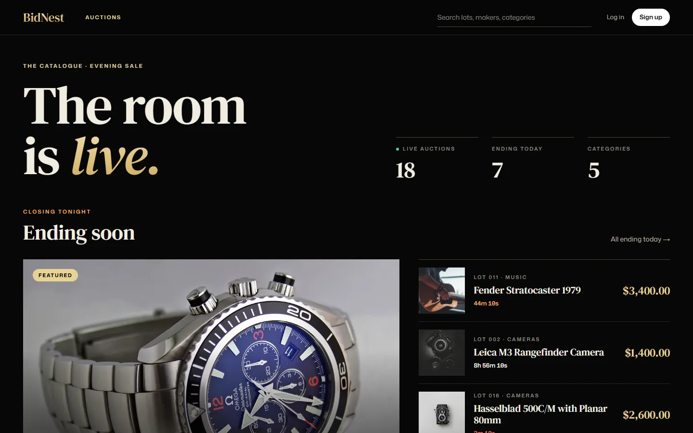
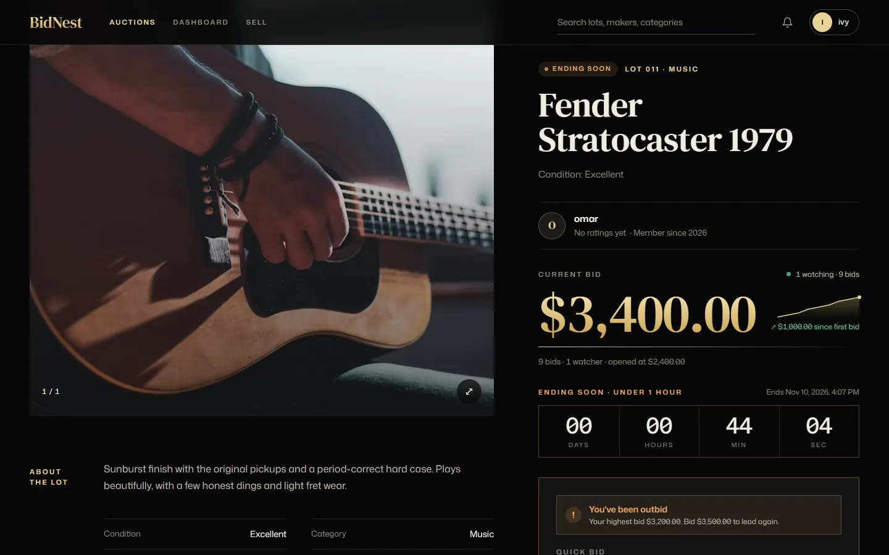
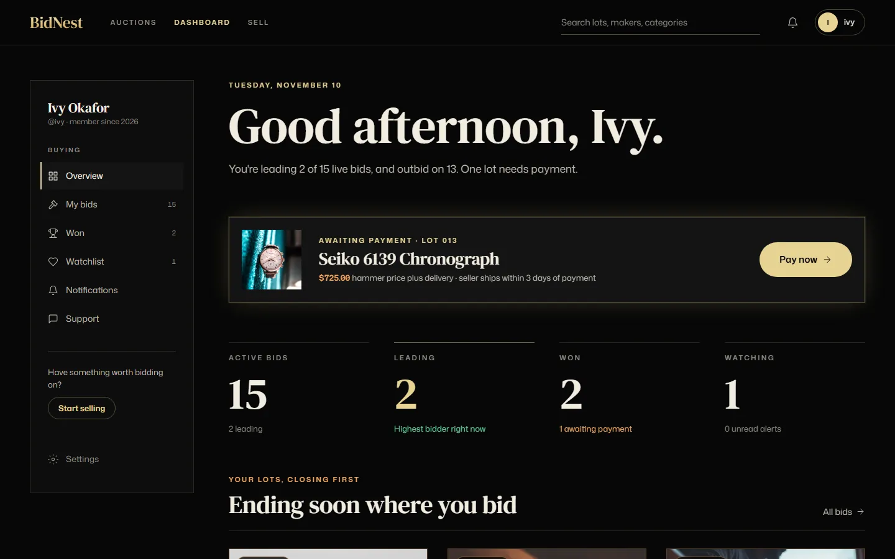
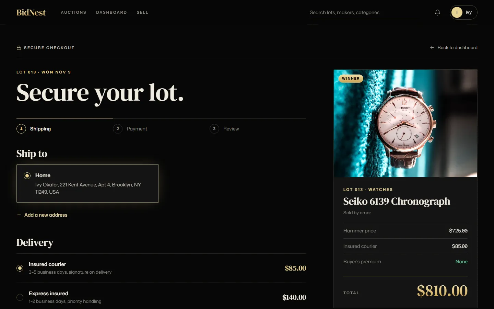
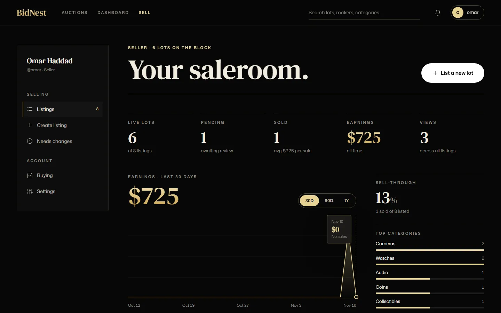
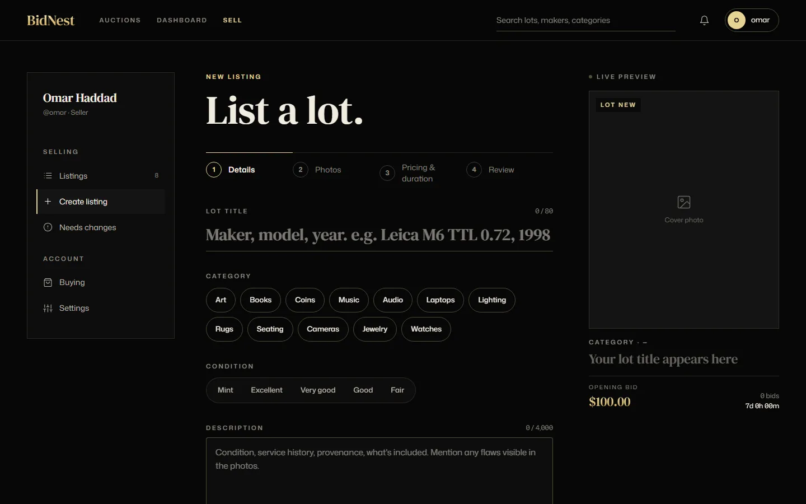
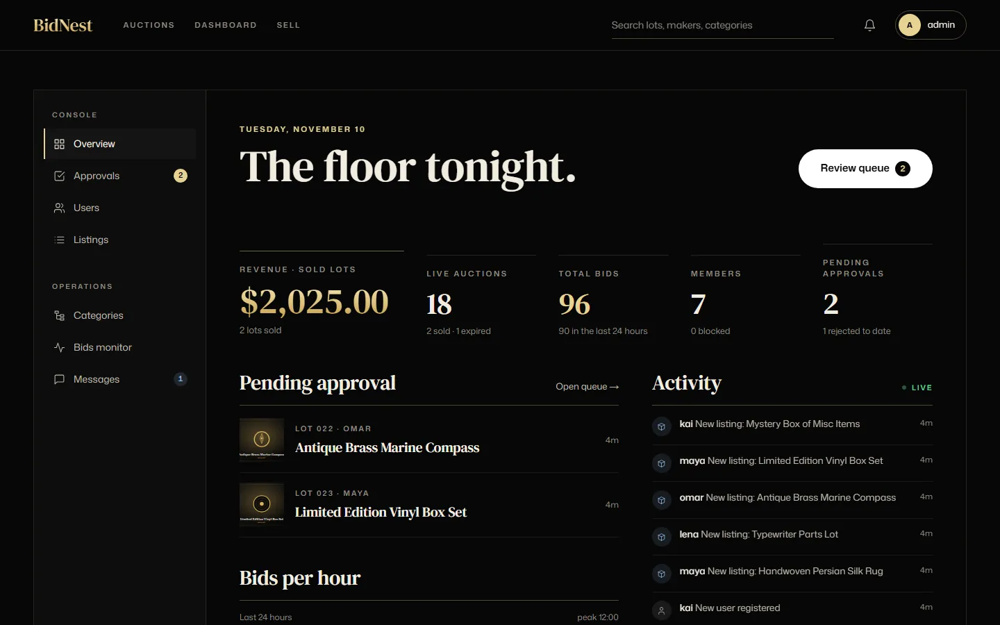
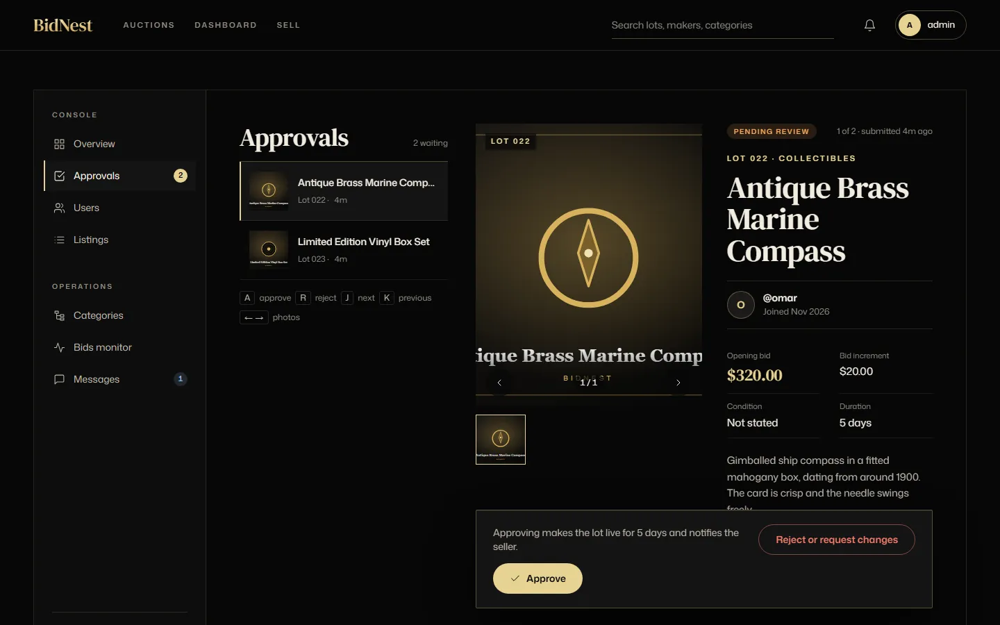
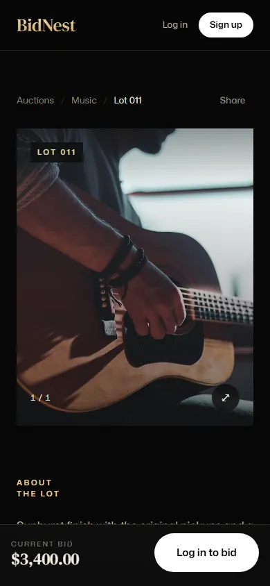

# BidNest

An online auction platform where sellers list items, buyers bid in real time, and administrators approve and moderate listings.

> **Status:** the overhaul is complete: a Next.js and TypeScript front end, an Express, Prisma and PostgreSQL API, and live bidding over Socket.io. The original ASP.NET Core application, built as a team project at Aptech, is kept in [`legacy/`](legacy).


## Screens

| | |
|---|---|
|  |  |
| **Browse**: search, filters and live countdowns | **Auction page**: live bids, automatic bidding and the bid ledger |
|  |  |
| **Buyer dashboard**: bids, wins, watchlist and payments due | **Checkout**: address, delivery and Stripe or demo payment |
|  |  |
| **Seller dashboard**: earnings, views and listing status | **New listing**: photos, draft and submit for approval |
|  |  |
| **Admin console**: live stats and activity | **Approvals**: approve or reject, with a one-minute undo |

On a phone the same pages reflow without sideways scrolling:

<p>
  
  
</p>

## The overhaul

| Part | Stack |
|---|---|
| [`web/`](web) | Next.js 15 (App Router), React 19, TypeScript, Tailwind CSS 4, TanStack Query, socket.io-client, GSAP and react-three-fiber on the landing page |
| [`api/`](api) | Express 4, TypeScript, Prisma 6, PostgreSQL, zod validation, cookie-based JWT sessions, multer uploads, Socket.io |
| Tests | Vitest and supertest for the API (with an embedded PostgreSQL), Playwright end-to-end tests for the web app |

**Highlights**

- **Live bidding.** Bids run inside a transaction that locks the item row, so two simultaneous bids can never both win. Every accepted bid is pushed instantly to everyone watching the auction, and outbid, won and approval notifications reach the right person in real time.
- **Automatic bidding.** Bidders can set a maximum. The system bids for them one increment at a time, only as far as needed; the higher maximum wins at one increment above the lower one, and the earlier maximum wins a tie.
- **Auction timer.** A background job closes finished auctions, picks the winner and sends "ending soon" reminders at 30, 15, 5 and 1 minutes.
- **Selling.** Sellers save drafts, edit them, then submit for approval. They get earnings charts, view counts and listing management. Admins approve or reject (with a one-minute undo), manage users, listings, categories (with ordering), bids and support threads.
- **Buying.** Buyers get a dashboard (bids, won items, watchlist, notifications), saved addresses, delivery options, a checkout with receipts, seller ratings, and a two-way support conversation.
- **Accounts.** Profile photos, public profile settings and per-channel notification preferences.
- **Payments.** With a Stripe test key the checkout uses Stripe's hosted page and records the order exactly once, from the return or the signed webhook. Without a key it falls back to a demo card form that only stores the brand and last four digits.
- **Landing page.** It keeps the original look. The 3D scenes load only when scrolled near and pause off screen, the models are compressed, and the hero video is 1080p, so the first load is about 5 MB instead of about 18 MB.

### Running it

You need Node.js 20 or newer.

```bash
cd api
cp .env.example .env        # set JWT_SECRET (instructions inside)
npm install
npm run db:dev              # local PostgreSQL on :5432 (or run `docker compose up -d` in the repo root)
npm run db:push && npm run db:seed
npm run dev                 # API on http://localhost:4000
```

```bash
cd web
cp .env.example .env
npm install
npm run dev                 # web app on http://localhost:3000
```

The seed creates demo data and accounts such as `admin@bidnest.test` and `maya@bidnest.test`; the shared demo password is in [`api/prisma/seed.ts`](api/prisma/seed.ts). It is for local development only. While the API runs with `NODE_ENV=development`, the login page also shows quick-login buttons for the demo accounts; the endpoint behind them does not exist in production.

### Card payments with Stripe (optional)

1. Put your test secret key in `api/.env` as `STRIPE_SECRET_KEY` (it starts with `sk_test_`).
2. Forward webhooks to the API with the Stripe CLI and put the signing secret it prints in `STRIPE_WEBHOOK_SECRET`:

   ```bash
   stripe listen --forward-to localhost:4000/api/webhooks/stripe
   ```

3. Restart the API. The checkout now sends the buyer to Stripe; use the test card `4242 4242 4242 4242`. The buyer's return to the site also confirms the payment, so the webhook is a safety net rather than a requirement.

Keys belong only in `api/.env`, which is ignored by git.

### Tests

| Command | What it covers |
|---|---|
| `npm test` in `api/` | The API against an embedded PostgreSQL: auth, bidding and automatic bidding, auctions and the timer, sockets, checkout and Stripe (with a stubbed client and signed test webhooks), drafts, support threads, avatars and the admin area |
| `npm run test:e2e` in `web/` | Playwright through the real browser UI, with the API and web app running: browsing, live bid updates, approvals and undo, drafts, support, maximum bids, profile photos, checkout and a mobile layout check |

The end-to-end tests sign in through the development-only quick login, so run them against a development API. If the browser Playwright expects is not installed, set `CHROMIUM_PATH` to an installed Chromium.

## The original application (in `legacy/`)

- **Stack:** ASP.NET Core 8 MVC, SQL Server with Entity Framework Core, cookie authentication, SignalR for live bidding, Razor views with Bootstrap, BCrypt password hashing.
- **Roles:** administrators, sellers and buyers, each with their own panel.
- **Features:** item listings with images and documents, categories, search, auctions and bidding, watchlist, notifications, ratings, contact messages and an admin panel.
- **Data model:** Users, Roles, Items, ItemImages, ItemDocuments, Categories, Bids, Watchlist, Notifications, Ratings and ContactMessages. The schema is in [`legacy/Database/`](legacy/Database).
- **Documentation:** the team's detailed analysis and screenshots are in [`Documentation/ORIGINAL_README.md`](Documentation/ORIGINAL_README.md), and the project presentation is in [`Documentation/`](Documentation).

### Running the original

1. Create a SQL Server database named `bidnest` from [`legacy/Database/database.sql`](legacy/Database/database.sql) (and the stored procedures in [`legacy/Database/Stored_procedure.sql`](legacy/Database/Stored_procedure.sql)).
2. Put your own SQL Server login in the `DefaultConnection` string of `legacy/BidNest/BidNest/appsettings.json`. The connection string is also hard-coded in `OnConfiguring` of `legacy/BidNest/BidNest/Models/BidnestContext.cs`; update it there as well. The original login was removed from this repository's history.
3. From `legacy/BidNest/BidNest`, run `dotnet run`.

## Credits

### Landing page

The landing page is built with React, Vite, Tailwind CSS, GSAP and three.js. It is adapted from the **JavaScript Mastery** tutorial "Stunning GSAP Cocktail Website" by Adrian Hajdin, then rebranded and extended for BidNest: new hero, sections, 3D scenes, content and styling.

### Third-party assets

The Bootstrap theme in [`legacy/Theme/`](legacy/Theme), the 3D models in `legacy/BidNest/BidNest/wwwroot/models`, and the "Modern Negra" demo font are third-party assets used under their own licences. Check those licences before any commercial use.

## History note

Generated build output (`bin/`, `obj/`, `.vs/`) and a local database login were removed from this repository's history. Authors, dates and commit messages were preserved. One early commit made up only of build output no longer exists as a result.
